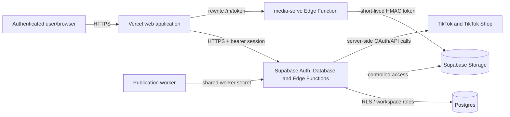

# AutoClip - Security Operations and Evidence Plan

**Owner:** AutoClip operator
**Review cadence:** monthly for Q3 and Q8; quarterly for Q2 and Q6; annually and after material changes for Q1 and Q7.
**Evidence location:** access-controlled repository or ticket system. Never store passwords, recovery codes, API keys, private keys, OAuth tokens, session tokens, or production database exports in this repository.

This document operationalizes the six open items in the security review. A check mark is evidence of an observed control only when the linked record includes the date, reviewer, result, and a sanitized supporting artifact. A template or a source-code review is not evidence that a cloud-provider setting is enabled in production.

## Q1 - Security policy approval and publication

Source policy: `artifacts/AutoClip_Information_Security_and_Privacy_Policy.pdf` (version 1.0, 30 October 2026).

Before representing the policy as effective, the authorized AutoClip operator must complete the approval record below, retain the signed copy in the controlled evidence location, and publish the approved version where affected personnel can access it.

| Required action | Owner | Evidence |
| --- | --- | --- |
| Confirm policy scope and legal entity/operator | AutoClip operator | Signed approval record |
| Approve version 1.0 or create a revised version | Authorized approver | Approver name, title, date, signature or approved electronic record |
| Publish the approved policy | AutoClip operator | Access-controlled URL or repository revision |
| Notify relevant administrators | AutoClip operator | Notification record or acknowledgement |
| Set next annual review date | AutoClip operator | Calendar/ticket reference |

**Approval record:** version ___; approver name/title ___; approval date ___; publication location ___; next review date ___.

## Q2 - Network and service architecture

The following is a source-code-supported architecture description. It must be reconciled with the active Vercel and Supabase project settings before it is treated as production evidence.

Observed in source code:

- The frontend directs API traffic to the configured Supabase URL and does not contain a service-role key.
- Edge Functions use a Supabase service-role key only server-side; user-facing functions validate user authorization or use restricted RPCs.
- CORS helpers echo only origins in the `WEB_URL` allow-list, never `*`.
- Database migrations enable row-level security and define workspace-scoped policies; token-bearing OAuth tables have no `anon` or `authenticated` grant.
- The Vercel rewrite for media routes requests to the Supabase `media-serve` function. The function requires a short-lived HMAC-signed token.

Quarterly production verification checklist:

| Check | Expected result | Evidence |
| --- | --- | --- |
| Vercel domains and deployments | Only approved production domains; HTTPS active | Sanitized dashboard screenshot or export |
| Vercel environment variables | Secrets scoped to production and not exposed as `VITE_*` | Redacted dashboard screenshot |
| Supabase API settings | No unexpected public redirects/origins; production URL is correct | Sanitized dashboard screenshot |
| Edge Function secrets | `SUPABASE_SERVICE_ROLE_KEY`, token-encryption key, worker/media secrets only in server secrets | Redacted secret-name inventory, not values |
| RLS and Storage policies | RLS enabled; bucket/object policies match tenant access model | SQL query/export and policy review record |
| External exposure | No unintended database, Storage, or admin endpoint exposed | Provider settings review record |

## Q3 - Ubuntu administrative workstation

Run `scripts/collect_ubuntu_security_evidence.sh` from the administrative workstation once each month and after a material configuration change. Attach its sanitized output to the evidence record. The script is read-only and deliberately does not print secrets.

Minimum acceptance criteria:

- Supported Ubuntu release and automatic security updates enabled.
- Outstanding security updates reviewed and applied according to risk.
- Host firewall status documented, including an explicit justification if it is disabled because no inbound services are exposed.
- A suitable endpoint protection/antimalware decision documented. On Ubuntu this may be a managed EDR, an on-demand scanner, or a documented risk-based decision; do not claim a product is active merely because its package is installed.
- Automatic screen lock after five minutes and immediate password lock confirmed by a practical test.

## Q6 - Encryption and secrets evidence

| Asset/control | Source-code evidence | Production evidence still required |
| --- | --- | --- |
| Browser/API transport | Application and integrations use HTTPS URLs | Browser/TLS check and approved Vercel domain evidence |
| TikTok/TikTok Shop tokens | Edge Functions encrypt stored tokens with AES-256-GCM; key is server-side | Supabase secret-name inventory; key-management/rotation record |
| Token database rows | Migrations restrict token-bearing tables to service-role backend access | RLS, grants, and function deployment review |
| Media access | `media-serve` verifies a short-lived HMAC token before serving media | Function configuration and expiry test record |
| Database and Storage encryption | Not established by this repository | Supabase provider documentation/configuration evidence applicable to the project |

Record at least quarterly: reviewer, date, Vercel/Supabase project identifiers, sanitized screenshots/exports, findings, remediation owner and closure date. Never export secret values or customer media as evidence.

## Q7 - Incident response operationalization

The response procedure is in `docs/INCIDENT_RESPONSE_RUNBOOK.md`. To make it operational:

1. Confirm the Incident Lead and monitored security mailbox.
2. Create an access-controlled incident register using the fields in the runbook.
3. Complete a tabletop exercise at least annually and after material changes to authentication, token handling, tenant authorization, or TikTok Shop processing.
4. Store the exercise record: scenario, participants, time, decisions, escalation/notification assessment, gaps, owners, due dates, and closure review.

Suggested first exercise: suspected exposure of a TikTok Shop refresh token for one workspace. Validate token revocation/rotation, affected-workspace identification, log preservation, customer/TikTok notification assessment, and safe recovery. Do not use real tokens in the exercise evidence.

## Q8 - Vulnerability management

### Operating cadence

- **Weekly:** monitor security advisories for deployed dependencies and cloud-provider notices.
- **Monthly:** run dependency checks, review Ubuntu updates, and record findings.
- **Before production release:** review security-relevant code and run the applicable automated tests.
- **After a critical advisory:** triage within one business day and document the disposition.

### Risk targets

| Severity | Triage target | Remediation target |
| --- | --- | --- |
| Critical | 1 business day | 7 calendar days or approved mitigation |
| High | 3 business days | 30 calendar days or approved mitigation |
| Medium | 10 business days | 90 calendar days |
| Low | Next planned review | Risk-based backlog |

### Required register fields

ID; discovery date; source; affected asset/version; severity; exploitability/context; decision; compensating control; owner; target date; remediation evidence; reviewer; closure date; exception approval and expiry.

Useful local checks include `npm audit --omit=dev` in the root and `apps/web` directories after dependencies are installed, `npm outdated`, and the project test suite. Record command version, timestamp, and full sanitized output. A clean local audit does not replace monitoring of Vercel, Supabase, operating-system, or TikTok supplier advisories.

## Monthly control record

| Month | Q3 workstation | Q6 encryption/secrets | Q8 vulnerabilities | Reviewer | Findings / ticket |
| --- | --- | --- | --- | --- | --- |
| YYYY-MM | Pending | Pending | Pending |  |  |
